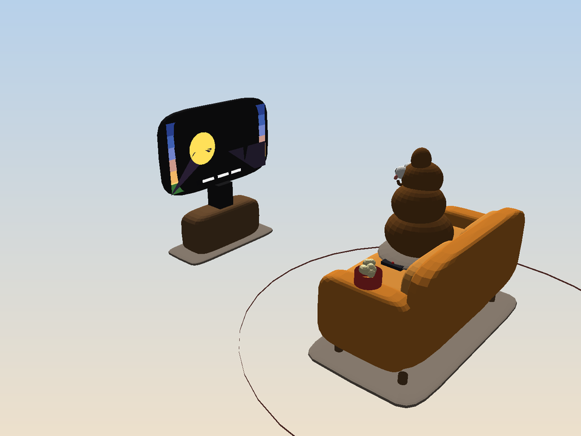
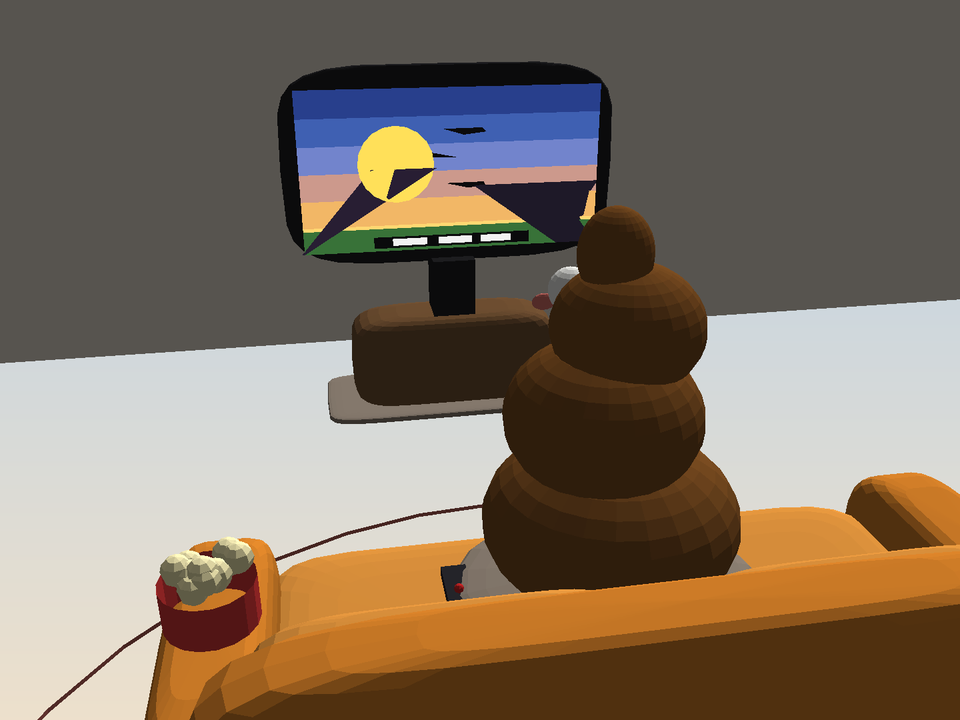
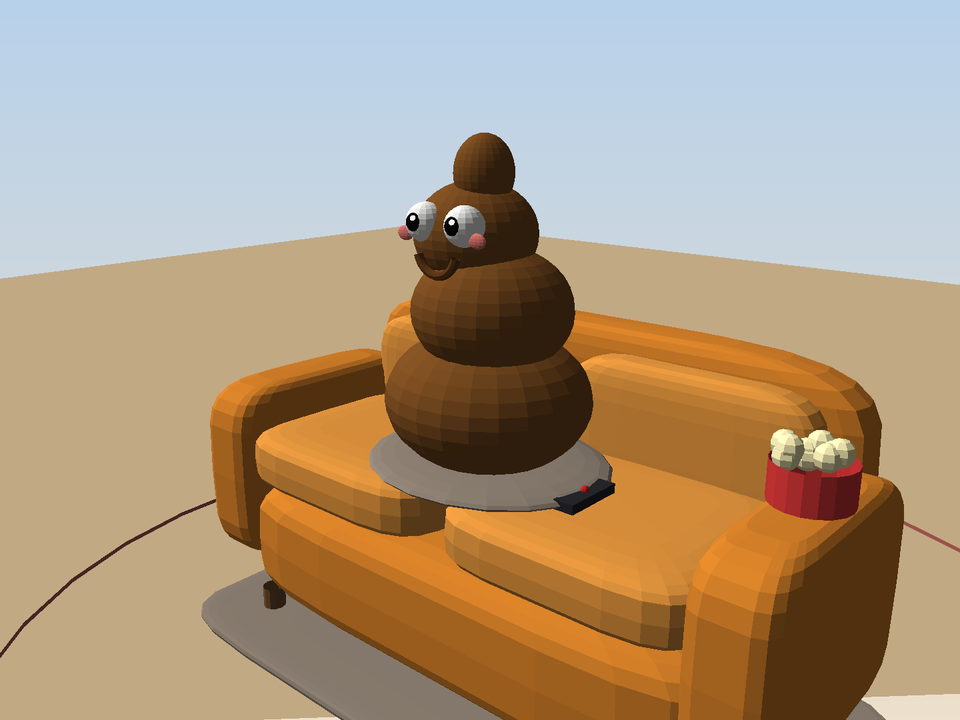

# caca

Modèle 3D procédural d'un caca assis sur un canapé, en train de regarder un film à la télé (avec bol de pop-corn et télécommande).

## Fichiers

- `scene.obj` + `scene.mtl` — modèle 3D Wavefront avec matériaux (8 276 sommets, 14 030 triangles)
- `scene.stl` — export STL (impression 3D / CAO)
- `make_scene.py` — générateur Python de la scène et des rendus (numpy + Pillow)
- `preview_epaule.png` — plan par-dessus l'épaule : le caca regarde le film
- `preview_face.png` — plan de la bouille du caca (yeux, sourire, joues)
- `preview_ensemble.png` — vue d'ensemble de la scène

## Aperçu







## Utilisation

Régénérer le modèle et les rendus :

```bash
pip install numpy pillow
python3 make_scene.py
```

Ouvrir le modèle dans Blender : `File > Import > Wavefront (.obj)` puis choisir `scene.obj` (les matériaux `scene.mtl` sont chargés automatiquement).
